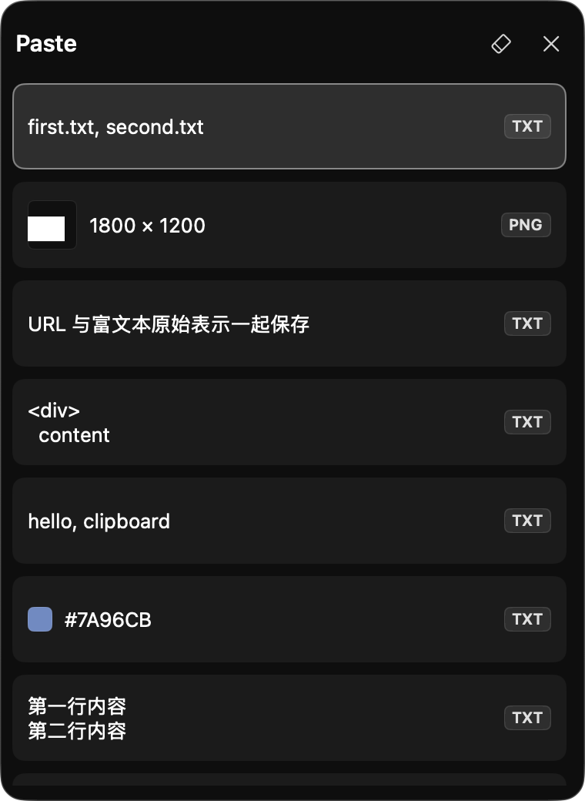
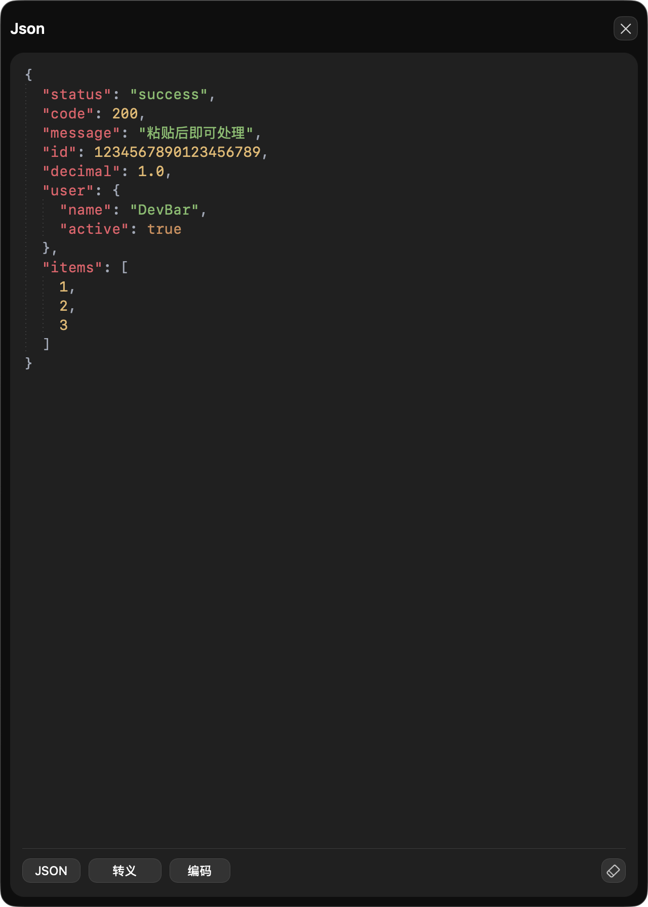
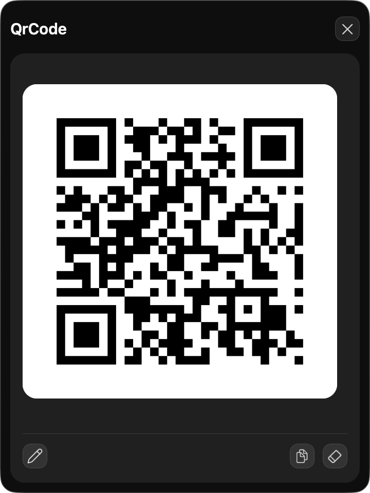
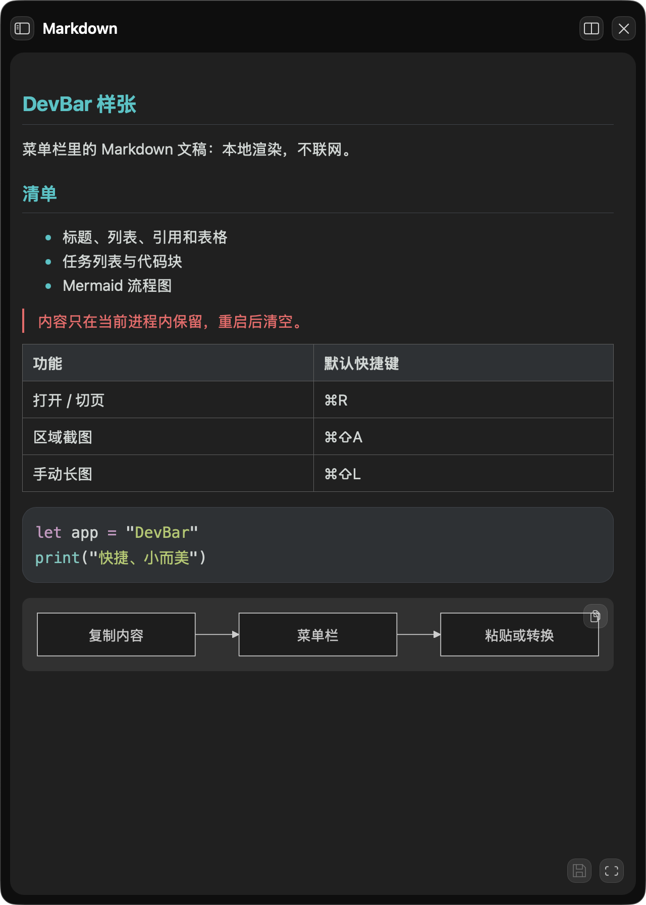
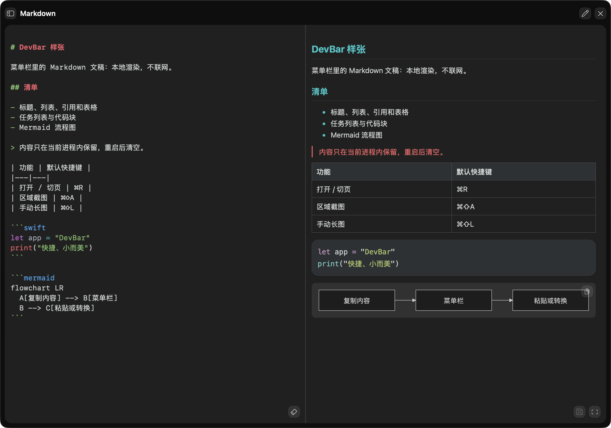

# DevBar

macOS 菜单栏里的本地小工具：剪贴板历史、JSON、二维码、Markdown，以及区域截图和手动滚动长图。快捷、极简、不联网。

- 四个页面：**Paste、Json、QrCode、Markdown**
- 一个菜单栏入口，默认 `⌘⇧D` 打开和切页
- 内容只在本机处理；界面中文，深色/浅色/自动外观

## 快捷键

| 快捷键 | 效果 |
|---|---|
| `⌘⇧D` | 全局：面板隐藏时打开；已显示时按启用顺序切页 |
| `⌘⇧V` | 全局：调出剪贴板预选卡片，继续按可循环切换 |
| `⌘⇧A` | 全局：区域截图 |
| `⌘⇧L` | 全局：手动滚动长图 |
| `⌘⇧P` | Markdown、QrCode：编辑 / 预览切换；Markdown 在三态间循环 |
| `⌘S` | Markdown：保存原文 |
| `⌘W` | 面板聚焦时关闭面板 |
| `↑` / `↓` | 剪贴板列表或预选卡片选择，两端循环 |
| `Enter` | 确认预选卡片；已授权辅助功能时直接粘贴 |
| `Esc` | 取消预选卡片、区域截图或长图采集 |
| `⌘Z` | 编辑区撤销 |

全局键都可在设置中修改；各页面还能单独录制专属快捷键。面板聚焦时按 `⌘W` 或点右上角 `×` 关闭。

## Paste

自动记录文本、图片和文件历史，默认 10 条，可在设置中改为 3–30 条。点击条目或按 `↑` / `↓` 选择后，内容会写入系统剪贴板，再到目标应用按 `⌘V`。悬浮可预览长文本和图片；顶栏清除按钮可一次清空历史，空历史时不可用。

拖拽条目：

- 拖到编辑器、聊天框等目标：按目标支持的类型插入原始文本、图片或文件。
- 拖到 Finder / 桌面：文本和图片生成 `DevBar-*.txt` / `DevBar-*.png` 文件；文件条目直接拖出原文件。
- 拖到屏幕顶部菜单栏：拖动卡片和指示线变红，松手删除该条历史及对应缓存；拖回则恢复。

`⌘⇧V` 打开预选卡片，`↑` / `↓` 切换，`Esc` 取消。按 `Enter` 时，只有前台仍是卡片出现时的应用且已授权辅助功能，才会发送一次 `⌘V`；否则提示“已复制，可按 ⌘V 粘贴”。

## Json

粘贴 JSON 后直接编辑，数字保持原写法：`12345678901234567890`、`1.0`、`1e10`、`-0`、`0.1000` 不会被悄悄改写。底部动作按钮按当前内容执行格式化/压缩、转义/反转义、URL 或 Base64 编码/解码；结果可撤销。顶栏可清空内容或切换纯色阅读背景。

不合法 JSON 不自动修复，只提示错误位置。也支持拖入 `.json`、`.jsonc`、`.geojson` 文件。

## QrCode

输入文本，按 `⌘⇧P` 生成二维码，再按一次回到编辑。空编辑器粘贴二维码文本，或全选替换后，会自动进入预览。预览态复制 PNG，编辑态复制文本；顶栏可清空内容。内容超过 2331 字节会提示，不会截断。

## Markdown

粘贴或打开 Markdown，按 `⌘⇧P` 在 **编辑 → 预览 → 编辑并预览** 之间循环。支持标题、列表、引用、表格、任务列表、代码块和 Mermaid；代码块和单张 Mermaid 图都有复制入口，单图出错不影响正文。顶栏提供清除、截全预览图和关闭，底栏提供预览、分栏和纯色阅读背景。

编辑并预览时，左侧编辑、右侧预览，两栏等宽：

标题栏左侧的目录按钮打开文稿目录，列出最近打开的文件和本次运行中未保存的文稿，也可以从底部选择文件。

- 拖入 `.md`、`.markdown`、`.mmd`、`.mermaid`，或直接拖到菜单栏图标后选择 Json / Markdown 投放区；单个文件上限 10MB，只支持 UTF-8。
- `⌘S` 保存原文并写回关联的 `.md` 文件；没有关联文件时先选保存位置。外部修改或删除原文件时拒绝覆盖。
- 顶栏的截全预览图把完整文稿渲染成 PNG，包含视口外内容，复制并保存到截图目录。

## 截图与长图

- `⌘⇧A` 区域截图：冻结屏幕后圈选，支持矩形、椭圆、箭头、画笔、文字、马赛克、撤销和保存。
- `⌘⇧L` 手动长图：自己滚动目标窗口，DevBar 负责拼接；`✓` 结束并复制，保存写文件，`×` 取消。
- 截图保存到设置里的截图目录，默认桌面；文件名以 `DevBar 截图` / `DevBar 长图` 开头，不覆盖旧文件。

## 安装

要求 **macOS 15 或更高版本**、Apple Silicon。macOS 26 使用 Liquid Glass，macOS 15 回退到系统毛玻璃材质。

解压分发包，把 `DevBar.app` 拖进“应用程序”。首次打开请右键选择“打开”。

首次使用时按提示允许剪贴板读取；区域截图和长图需要屏幕采集权限；辅助功能权限只用于预选卡片的定位与 `Enter` 直接粘贴，不授权也能手动 `⌘V`。

## 数据与设置

默认数据目录：`~/Library/Application Support/DevBar`，可在设置中迁移；截图目录独立设置。

- Paste 历史会持久保存，删除条目或调小上限会清理旧记录。
- Json、QrCode、Markdown 的文本是本次运行会话，重启后清空；页面顺序、主题、快捷键和历史上限会保留。
- 设置里可调整外观、页面顺序和是否参与 `⌘⇧D` 循环、快捷键、剪贴板历史上限、“内容为空时带入剪贴板”以及权限入口。
