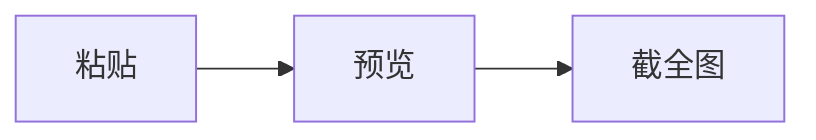
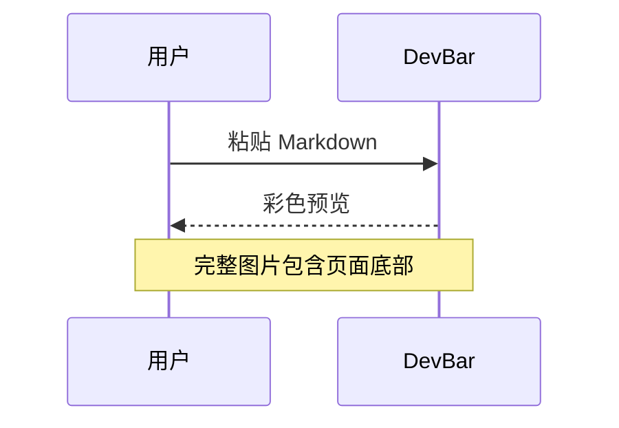

# DevBar 文稿预览

代码保持彩色高亮，表格中的数字保持原文。

```typescript
const item = { id: 1234567890123456789n, active: true };
console.log(item);
```

| 项目 | 数量 | 说明 |
| --- | ---: | --- |
| 示例 | 007 | 前导零不改写 |
| 金额 | -0.1000 | 小数保留 |



## 后半部分



这是截图的最后一段。
