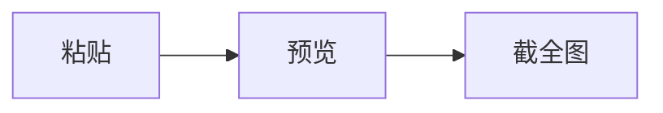
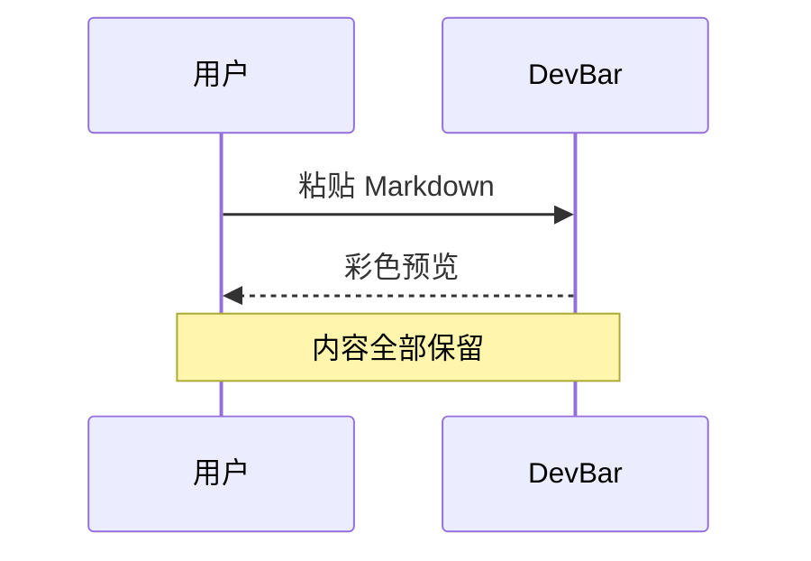
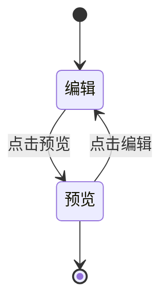
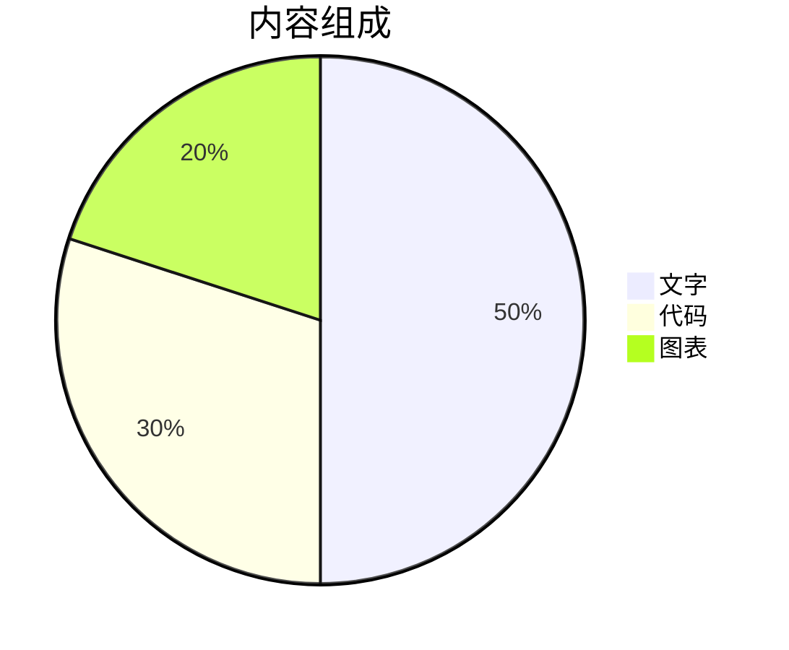
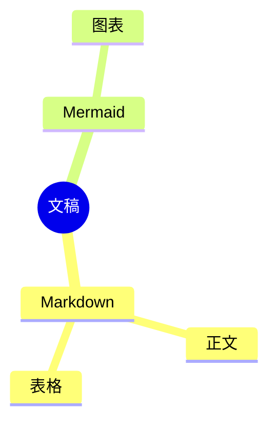

# DevBar 深色长文稿

混合正文、代码高亮、表格和 Mermaid 的完整截图。

## 第 1 节：文字与结构

这是一段连续阅读的正文。代码、数字和中文保持原样，预览没有额外的结果区，长图包含滚动区以外的内容。

**重点文字**、*斜体*与 `inline code` 也都包含在这张图片中。

- 简洁的正文排版
- 彩色代码高亮
- 图表与表格混排

```typescript
const data = { id: 1234567890123456789n, enabled: true };
console.log(data);
```

| 项目 | 数值 | 说明 |
| --- | ---: | --- |
| 标识 | 007 | 前导零保留 |
| 大整数 | 1234567890123456789 | 不经过浮点数 |
| 小数 | -0.1000 | 保持写法 |



> 第 1 节结束，下面还有后续内容。

## 第 2 节：文字与结构

这是一段连续阅读的正文。代码、数字和中文保持原样，预览没有额外的结果区，长图包含滚动区以外的内容。

**重点文字**、*斜体*与 `inline code` 也都包含在这张图片中。

- 简洁的正文排版
- 彩色代码高亮
- 图表与表格混排

```python
def preview(text: str) -> str:
    return text.strip()
print(preview("DevBar"))
```

| 项目 | 数值 | 说明 |
| --- | ---: | --- |
| 标识 | 007 | 前导零保留 |
| 大整数 | 1234567890123456789 | 不经过浮点数 |
| 小数 | -0.1000 | 保持写法 |



> 第 2 节结束，下面还有后续内容。

## 第 3 节：文字与结构

这是一段连续阅读的正文。代码、数字和中文保持原样，预览没有额外的结果区，长图包含滚动区以外的内容。

**重点文字**、*斜体*与 `inline code` 也都包含在这张图片中。

- 简洁的正文排版
- 彩色代码高亮
- 图表与表格混排

```swift
let title = "DevBar"
let enabled = true
print(title, enabled)
```

| 项目 | 数值 | 说明 |
| --- | ---: | --- |
| 标识 | 007 | 前导零保留 |
| 大整数 | 1234567890123456789 | 不经过浮点数 |
| 小数 | -0.1000 | 保持写法 |



> 第 3 节结束，下面还有后续内容。

## 第 4 节：文字与结构

这是一段连续阅读的正文。代码、数字和中文保持原样，预览没有额外的结果区，长图包含滚动区以外的内容。

**重点文字**、*斜体*与 `inline code` 也都包含在这张图片中。

- 简洁的正文排版
- 彩色代码高亮
- 图表与表格混排

```sql
SELECT name, count(*) AS total
FROM documents
GROUP BY name;
```

| 项目 | 数值 | 说明 |
| --- | ---: | --- |
| 标识 | 007 | 前导零保留 |
| 大整数 | 1234567890123456789 | 不经过浮点数 |
| 小数 | -0.1000 | 保持写法 |



> 第 4 节结束，下面还有后续内容。

## 第 5 节：文字与结构

这是一段连续阅读的正文。代码、数字和中文保持原样，预览没有额外的结果区，长图包含滚动区以外的内容。

**重点文字**、*斜体*与 `inline code` 也都包含在这张图片中。

- 简洁的正文排版
- 彩色代码高亮
- 图表与表格混排

```json
{"id":1234567890123456789,"decimal":1.0,"active":true}
```

| 项目 | 数值 | 说明 |
| --- | ---: | --- |
| 标识 | 007 | 前导零保留 |
| 大整数 | 1234567890123456789 | 不经过浮点数 |
| 小数 | -0.1000 | 保持写法 |



> 第 5 节结束，下面还有后续内容。

## 完整截图终点

这是深色混合长图的最后一段。五节正文、五段代码、五张表格和五张图已经全部包含。
