# 文稿排版样张

在菜单栏里，粘贴后就能阅读。正文保持清楚、克制；中文与 English 混排，数字 007 和 12345678901234567890 都保留原文。第二行原文不会强行折行。

## 阅读与链接

[普通点击不跳转](https://example.com/path?q=one)；按住 ⌘ 点击才交给系统浏览器。裸地址 https://example.com 不自动变成链接。行内代码 `const value = 1.0` 保持等宽。

> 引用帮助区分补充信息，而不抢走正文的注意力。
> 两行引用属于同一段。

### 任务列表

- [x] 完成管线与安全清理
- [ ] 等待图表和高亮集成
- 普通列表

#### 四级标题

有序步骤：

1. 粘贴文稿
2. 切换预览

##### 五级标题

保留少量层级即可。

###### 六级标题

正文的可读性比标题字号更重要。

---

## 数字表：原样显示

| 名称   | 数值                 | 空列 |
| ------ | -------------------- | ---- |
| 编号   | 007                  |      |
| 大整数 | 12345678901234567890 |      |
| 负数   | -42                  |      |
| 小数   | 0.1000               |      |
| 千分位 | 1,234.50             |      |
| 百分比 | +12.5%               |      |
| 空值   |                      |      |

## 显式对齐优先

| 左对齐数字           | 居中数字 | 右对齐数字 |
| :------------------- | :------: | ---------: |
| 007                  |   007    |        007 |
| 12345678901234567890 |  -12.5   |     0.1000 |

## 宽表：在卡片内横向滚动

| 一月 | 二月 | 三月 | 四月 | 五月 | 六月 | 七月 | 八月 | 九月 | 十月 | 十一月 | 十二月 |
| ---- | ---- | ---- | ---- | ---- | ---- | ---- | ---- | ---- | ---- | ------ | ------ |
| 101  | 102  | 103  | 104  | 105  | 106  | 107  | 108  | 109  | 110  | 111    | 112    |
| 201  | 202  | 203  | 204  | 205  | 206  | 207  | 208  | 209  | 210  | 211    | 212    |

## 长中文与空值

| 项目   | 描述                                                                                                           | 代码                          |
| ------ | -------------------------------------------------------------------------------------------------------------- | ----------------------------- |
| 长段落 | 这是一段需要自然换行的中文说明，用来检查窄面板里的单元格不会被挤成一字一行，同时也不会无限伸长而失去阅读节奏。 | `do_not_wrap_this_identifier` |
| 留空   |                                                                                                                | `007`                         |

## 十种语言

### javascript

```javascript
const value = "hello"; // comment
```

### typescript

```typescript
const value: number = 42;
```

### json

```json
{ "large": 12345678901234567890, "ok": true }
```

### swift

```swift
let value: String = "你好"
```

### python

```python
value = True  # comment
```

### go

```go
var value string = "hello"
```

### java

```java
final String value = "hello";
```

### kotlin

```kotlin
val value: String = "hello"
```

### sql

```sql
SELECT name FROM users WHERE id = 42;
```

### shellscript

```shellscript
echo "hello" # comment
```

## 图表 flowchart

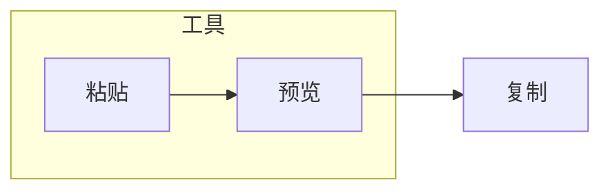

## 图表 sequence

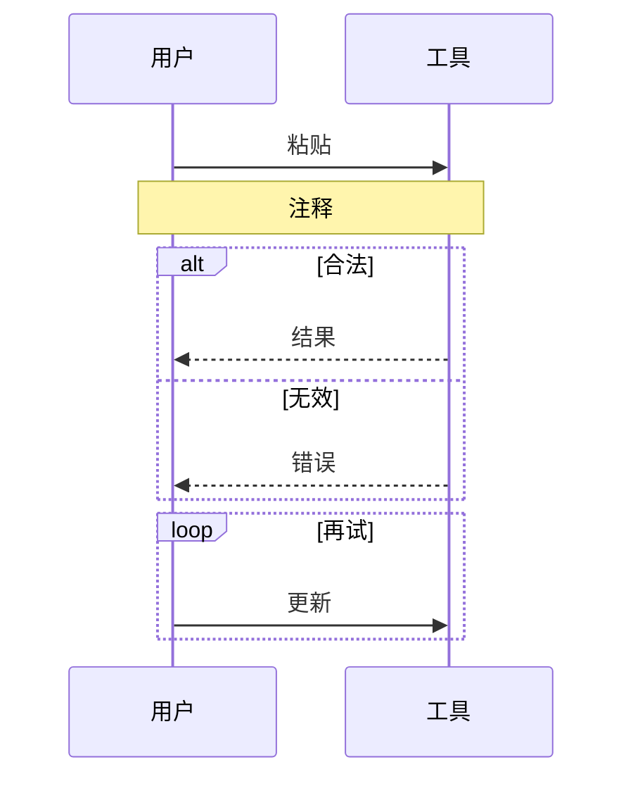

## 图表 class

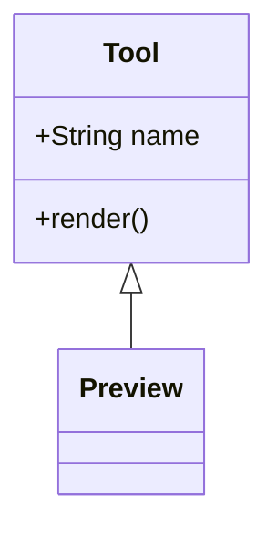

## 图表 state

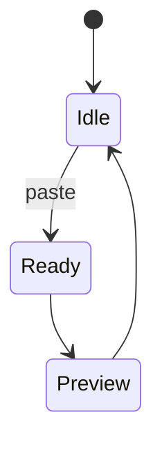

## 图表 er

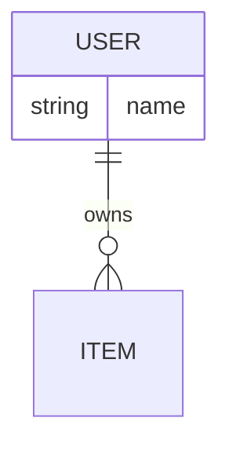

## 图表 journey

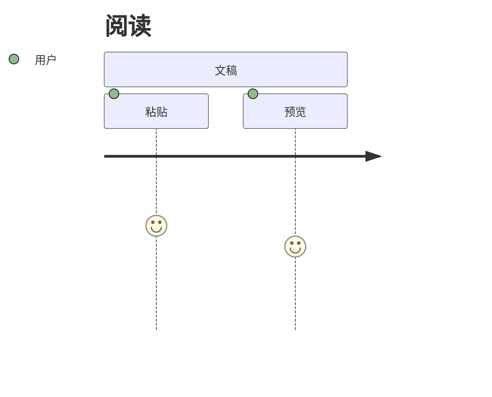

## 图表 gantt

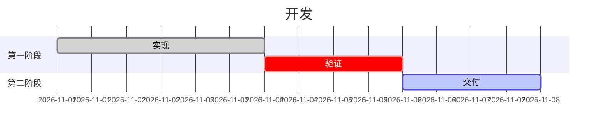

## 图表 pie

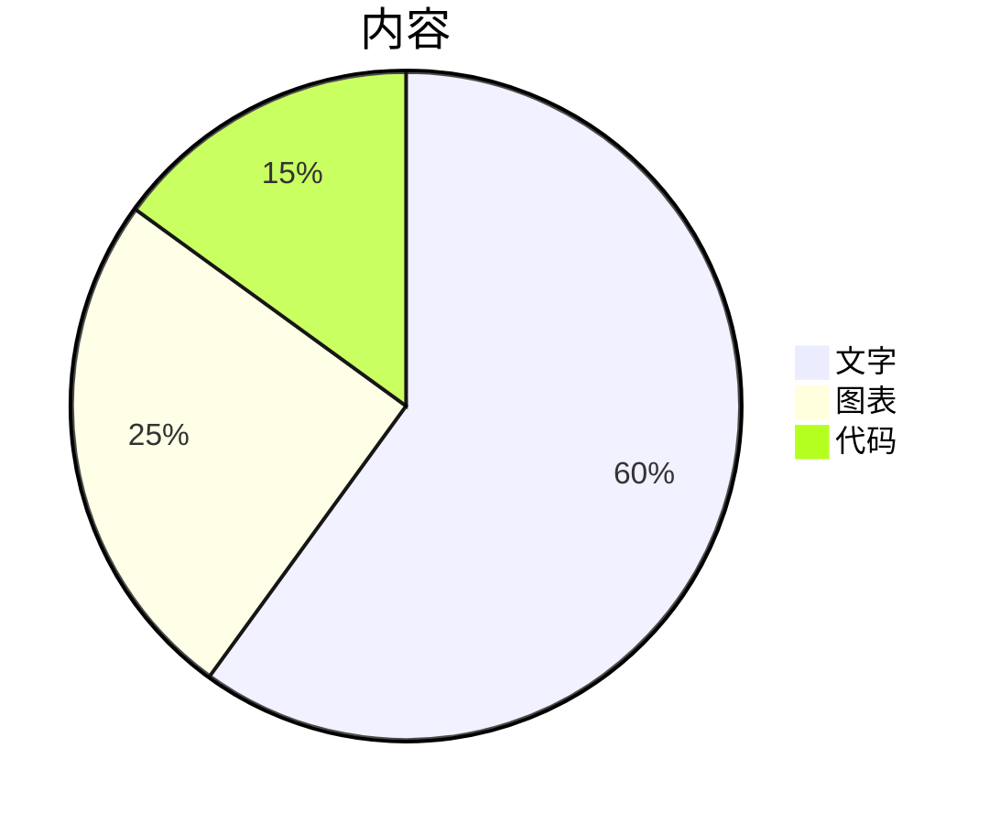

## 图表 requirement

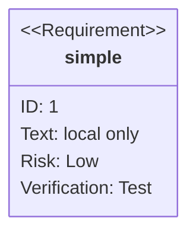

## 图表 gitGraph

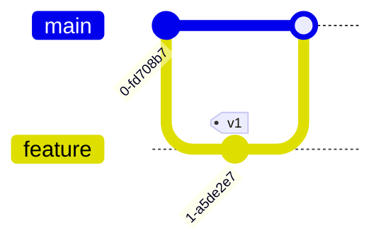

## 图表 mindmap

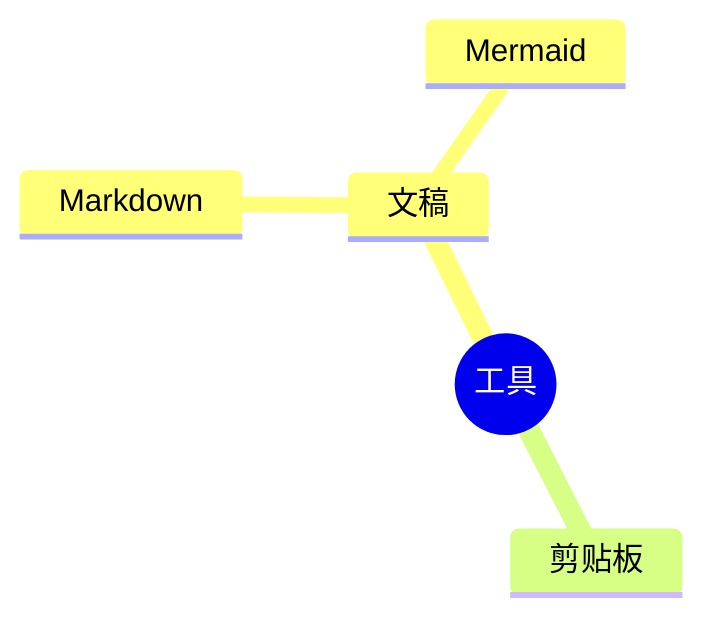

## 图表 timeline

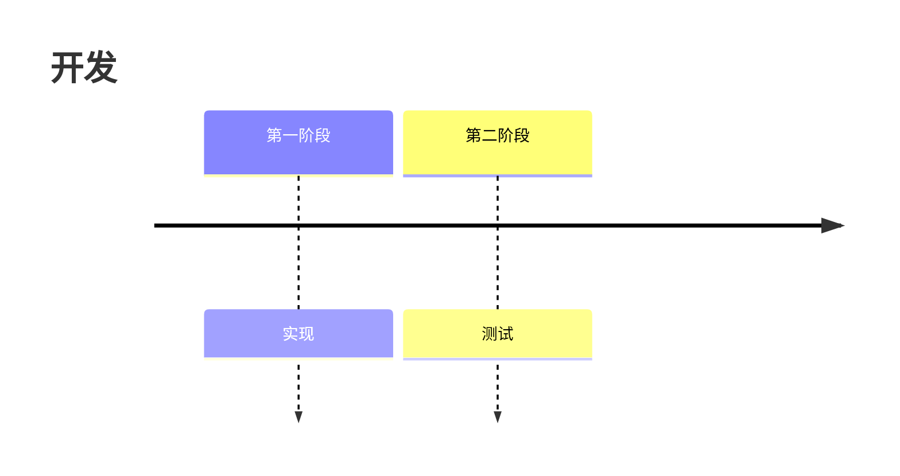

## 图表 quadrant

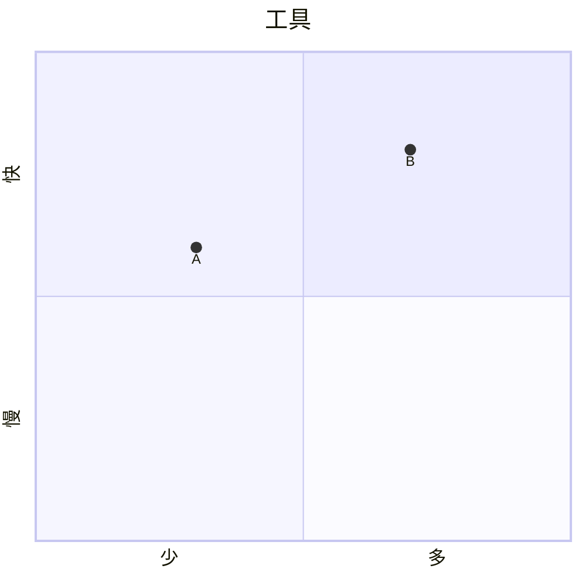

## 图表 xychart

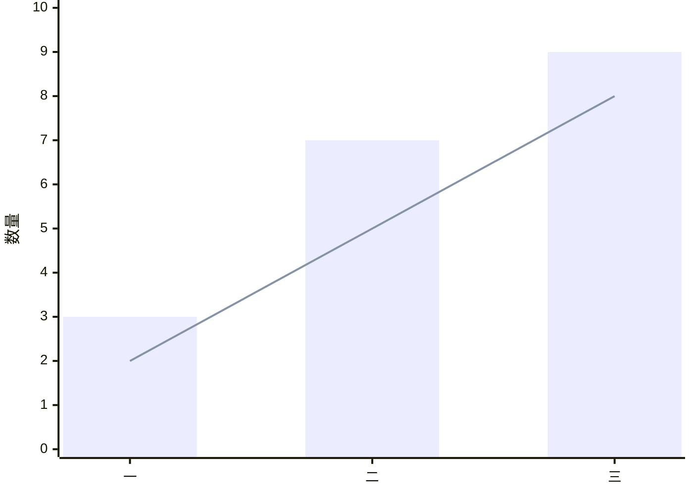

## 图表 sankey

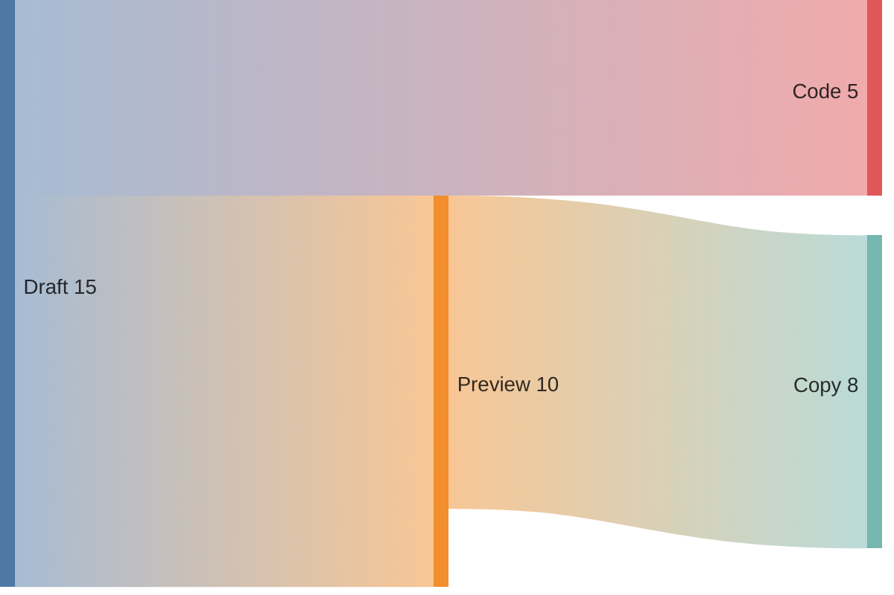

## 图表 block


## 图表 C4

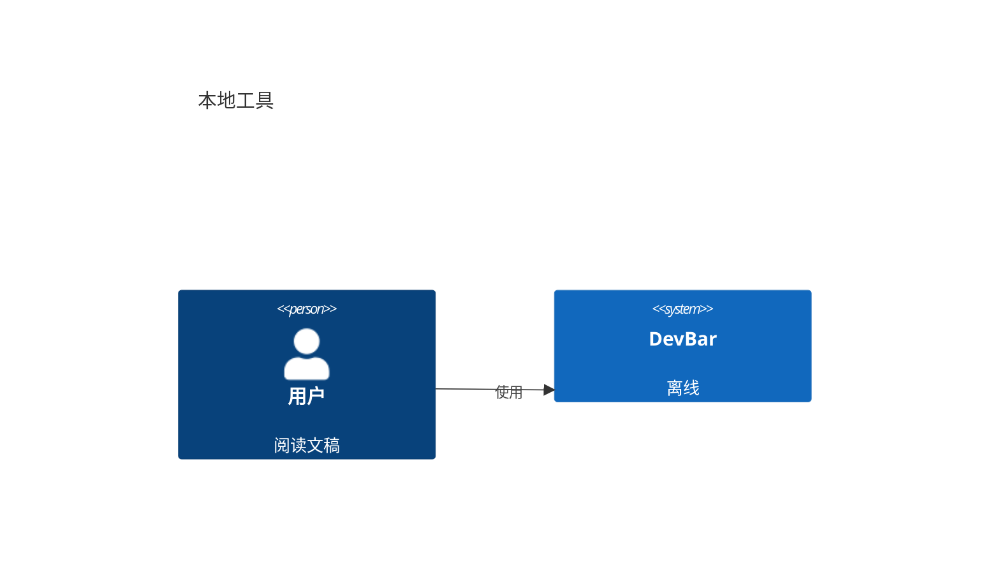

## 图表 init


## 图表 frontmatter


## 图表 explicit-color


## 图表 wide

```mermaid
flowchart LR
 A[第一步] --> B[第二步] --> C[第三步] --> D[第四步] --> E[第五步] --> F[第六步] --> G[第七步] --> H[最后一步]
```

## 图表 error

```mermaid
flowchart LR
 A[broken
```

## 图表 after-error

```mermaid
flowchart LR
 A[错误之后] --> B[仍然渲染]
```
